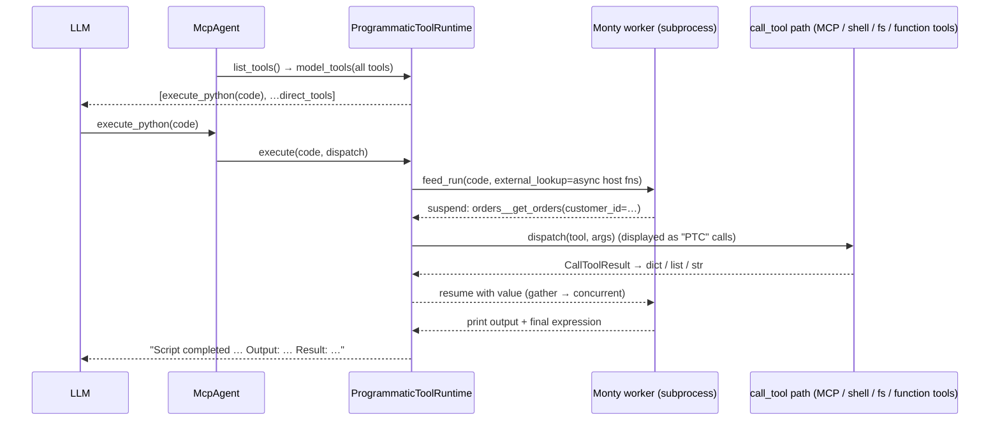

# Programmatic tool calling (PTC) for fast-agent

Status: proof of concept on `feat/ptc-monty-poc` (`fast-agent go --ptc`). Plan reconciled with the code in the commit that adds sandbox file I/O (`ptc/files.py`) and the functions-not-tools wording.

## 1. What Codex does ("code mode")

Codex (`~/reference/codex/codex-rs`) calls this **code mode**. The pieces are:

| Concern | Codex implementation |
| --- | --- |
| Feature gates | `features.code_mode` adds `exec`/`wait` next to direct tools; `features.code_mode_only` makes them the *only* model-visible tools (`core/src/tools/spec_plan.rs`, `ToolMode::{Direct, CodeMode, CodeModeOnly}`). |
| Model-facing tool | `exec`: a **freeform/custom tool** with a Lark grammar, so the model sends raw JavaScript rather than JSON-escaped code (`core/src/tools/code_mode/execute_spec.rs`). An optional first-line pragma `// @exec: {"yield_time_ms":…, "max_output_tokens":…}` sets per-call budgets. |
| Tool catalogue | `code-mode-protocol/src/description.rs` renders every nested tool as a TypeScript declaration (`tools.name(args: {...}): Promise<...>`) from its JSON input schema, with property descriptions as comments. MCP output schemas become `CallToolResult<Structured>`, and a shared MCP TypeScript preamble is included. Names are normalised to JS identifiers. In `code_mode_only` the whole catalogue goes into the `exec` description; in hybrid mode tools are discoverable through `ALL_TOOLS` / `tools.tool_search`. |
| Runtime | V8 isolate per "cell" (`code-mode-runtime`), hosted out of process (`code-mode-host`, gRPC/stdio), so crashes and memory blowups are isolated. There is no filesystem, network or console. |
| Helpers | `text()`, `image()`, `audio()`, `notify()`, `yield_control()`, `exit()`, `store()/load()` for cross-cell state, and `setTimeout`. |
| Nested calls | The runtime calls back into the host. `CodeModeDispatchBroker` turns each nested call into a normal `ToolCall` and routes it through the **same tool router** (`ToolCallSource::CodeMode{cell_id}`), so approvals, sandboxing, hooks and telemetry still apply. MCP tools return the full `CallToolResult` object to the script. |
| Long-running | If a cell is still running after `yield_time_ms`, `exec` returns `Script running with cell ID …`. The companion `wait` tool (`cell_id`, `yield_time_ms`, `max_tokens`, `terminate`) resumes or kills it. |
| Output | A header (`Script completed/failed`, `Wall time …`, `Output:`) followed by the content items, truncated to `max_output_tokens`. |

Pydantic AI's harness (`pydantic_ai_harness/code_mode`) does the same thing on **Monty**: a single `run_code` tool with keyword-only async stubs, a REPL that persists across calls, "last expression is the result" semantics, and errors returned as retry text. It also has optional eager or speculative execution while code is still streaming.

## 2. Mapping to fast-agent + Monty



| Codex | fast-agent PoC |
| --- | --- |
| JavaScript in V8, out of process | Python in **pydantic-monty** (Rust interpreter; `AsyncMonty` worker pool in a subprocess) |
| TypeScript declarations | Python `async def` **stubs** generated from JSON schemas (`ptc/stubs.py`). The same text is shown to the model *and* passed to Monty's bundled `ty` type checker (`type_check_stubs`), so wrong tool names, wrong arguments, unsupported imports and undefined names are rejected **before any tool runs**. Codex has no equivalent. |
| `tools.x(...)` namespace | Bare global functions resolved lazily via `external_lookup`. Names are sanitised to identifiers; builtin and stdlib-module shadows get a `_tool` suffix and keywords get `_` (`list` → `list_tool`, `from` → `from_`). |
| `store()/load()` | The same: every `execute_python` run gets a fresh Monty sandbox, and `store(key, value)` / `load(key)` / `stored()` (`ptc/store.py`) carry plain data between runs. The store is saved beside the agent's history in fast-agent sessions, so `--resume` and forks keep it. |
| `text()` / final output | `print()` plus the value of the final expression. |
| Dispatch broker through the tool router | `McpAgent.call_tool` intercepts `execute_python`. Nested calls go to `_dispatch_tool_call`, the original `call_tool` body, so MCP routing, ACP permission handlers, shell, filesystem, skills and function tools all work. |
| `code_mode_only` / `code_mode` | `ptc.enabled` gives "only" mode; `ptc.direct_tools` (fnmatch) gives hybrid. |
| Output budget | The existing `bound_tool_result_for_llm` byte limit applies to the `execute_python` result. |

## 3. What the PoC implements

- `src/fast_agent/ptc/`
  - `stubs.py`: JSON schema → keyword-only async stubs. It handles enums (`Literal`), unions, arrays, optional parameters (exact schema type with a `= ...` default; omitted arguments are not sent, explicit `None` is only accepted for nullable fields), `**kwargs` only for explicitly open schemas (`additionalProperties: true` or a schema), so a misspelled argument is still a type error, output schemas (rendered as a compact `Returns: {...}` shape in the docstring; the return annotation stays `dict[str, Any]`), and identifier and collision handling. Docstrings are escaped triple-quoted literals, so the model and the type checker see the same readable multi-line text.
  - `values.py`: `CallToolResult` → sandbox value. A tool's program value (`_meta["fast-agent-ptc-value"]`) wins, even on an error result. Otherwise it prefers `structuredContent`, parses JSON text, and turns media into handles. *(Uncommitted)* A structured result that also has non-text blocks becomes `{"structured_content": ..., "content": [...]}` instead of merging a `media` key into the server's fields. Other `isError` results raise `ToolCallFailed` (a `RuntimeError`) named after the sandbox function, e.g. `edit_file: old_string was not found [no_match]`. The message comes from `_meta["fast-agent-ptc-error"]` when the tool sets it, otherwise from the error text, with JSON `{error, message}` bodies summarised.
  - `runtime.py`: `ProgrammaticToolRuntime`. It owns a lazily started `AsyncMonty` pool and checks out a fresh session for every run, with limits (`max_feed_duration_secs`, `max_memory`, a high `max_suspensions`). Runs are serialised with a lock. Fresh sessions replaced one persistent REPL because Monty's REPL type checker pins each variable to the type of its first value (as a stub-file declaration) and forgets names set by failed or unchecked runs, which rejected about 4% of Haiku's scripts. Clearing the conversation empties the store. Every session first runs a prelude that pre-imports `asyncio` and defines `settle(aw)` (reserved, so no tool can shadow it), which returns an exception instead of raising, so `gather` can collect partial results (Monty does not support `return_exceptions=`). Printed output is capped at 1M characters host-side. Results use a Codex-style header; failures list the tool calls that already completed so the model doesn't repeat side effects.
  - `syntax.py`: syntax errors, including those reported by the type checker, are described with CPython's parser plus a hint for nested triple quotes. The code never runs.
  - `files.py`: sandbox file I/O through the agent's tools. Monty's `os=` callback answers `open()`, `pathlib` and the `os` file functions with nested tool calls: text reads use `read_text_file`, whole-file text writes use `write_text_file`, and binary data, appends, metadata, listings, walks/globs, `mkdir`/`unlink`/`rmdir`/`rename` use small POSIX scripts run by the shell tool (binary data as base64; failures come back as `FileNotFoundError`, `FileExistsError` and so on). The same permissions, hooks and execution environment apply as for a direct tool call. The session's working directory is the shell's, so relative paths and `os.getcwd()` match the tools. Writes are buffered and committed before the next other file operation or tool call and at the end of the script (also after an error), so a loop of `f.write()` costs one tool call. `Path.resolve()` does not resolve symlinks. pydantic-monty 1.3's type-checker stubs omit `open`, the `OSError` subclasses, `os.walk` and `os.scandir`, although the runtime has them: the builtins are declared in our stubs, and a snippet whose only type errors are the two `os` functions is re-run without type checking.
  - Direct I/O attempts that remain unsupported (`subprocess` and similar imports, or any file access when the agent has no file or shell tools) fail with an appended hint naming awaited tool-function calls; un-awaited tool calls are flagged; a direct model call to a code-only tool is answered with how to call it from `execute_python`.
  - Wording: the sandbox callables are always called *functions*; *tool* is reserved for what the model can call directly (`execute_python`, and functions also exposed as direct tools). Models answer "tool" with a direct tool call, so the description uses the word once, in a sentence mapping "use the `x` tool" in other instructions to `await x(...)` in code. Shell notes name the actual shell function, and the result header counts `calls`. Prompted by Haiku 5.5 (low) on TB2.1: 11% with PTC vs 79% without, most trials never calling a function from code.
- `Settings.ptc` (`ProgrammaticToolCallingSettings`): `enabled`, `direct_tools`, `nested_tools`, `tool_format`, `type_check`, `max_duration_seconds` (sandbox compute time only, not time spent waiting on tools), `max_memory_mb`.
- Structured shell and process values (`tools/shell_program_value.py`), section 6.2.
- `fast-agent go --ptc` sets `ptc.enabled` at runtime.
- `McpAgent` integration: `list_tools()` swaps in the code tool, `call_tool()` intercepts it, and nested calls are shown as `(PTC)` tool calls. The code tool carries `{"variant": "code", "language": "python"}` metadata so the existing code display renders highlighted Python while streaming.
- Optional dependency: `fast-agent-mcp[ptc]` (`pydantic-monty>=1.2.0`). It is also in the dev group. A clear `AgentConfigError` is raised if it is missing.
- Demo: `examples/ptc/` (order-analytics and media MCP servers, config, and `evals.py`).
- Tests: `tests/unit/fast_agent/ptc/test_ptc_runtime.py` runs real Monty for concurrency, persistence, name mapping, type-check rejection, error semantics and cancellation. A test there also checks that the module list in the instructions matches Monty. `test_ptc_freeform.py` covers freeform input, `tools/test_shell_program_value.py` the shell values, `commands/test_tools_ptc_surface.py` `/tools`, and `test_go_command.py` the CLI flag.

### End-to-end evidence (gpt-6-astra via Codex OAuth)

Question: "Which EMEA customer has the highest total revenue from delivered orders? … and the runner-up."

```bash
cd examples/ptc
uv run fast-agent go --ptc --servers orders -m "Which EMEA customer has the highest …"
```

The model's single `execute_python` call (reformatted by ruff; the model wrote it as five lines):

```python
import asyncio

customers = (await orders__list_customers(region="EMEA"))["customers"]
results = await asyncio.gather(*[orders__get_orders(customer_id=c["id"]) for c in customers])
ranked = sorted(
    [
        {
            "name": c["name"],
            "id": c["id"],
            "amount": sum(o["total"] for o in r["orders"] if o["status"] == "delivered"),
        }
        for c, r in zip(customers, results)
    ],
    key=lambda x: x["amount"],
    reverse=True,
)
print(ranked[:2])
```

| | direct | `--ptc` |
| --- | --- | --- |
| Model turns | 3 | 2 |
| Model-visible tool calls | 6 | 1 (6 nested, concurrent) |
| Tool-result chars in context | 10,768 | 293 |
| Input tokens | 7,766 | 5,282 |
| Answer | Stark C006 $9,703.40, Aperture | same (correct) |

`--ptc --shell` also works. The shell tool becomes a keyword-argument function (even when its model-facing form is freeform text) that returns `{stdout, stderr, exit_code, status, …}`, and keeps its own output display.

## 4. Roadmap

### Phase 1: harden the PoC
1. **Hooks and approvals for nested calls.** Still open. Nested calls go through `_dispatch_tool_call` and bypass `ToolRunnerHooks.before_tool_call/after_tool_call`, which only fire for model-visible calls. Route nested calls through a shared "execute planned call" seam, as Codex does with `ToolCallSource::CodeMode`, so hooks and tool-call planning metadata apply. ✅ Already done: nested calls are recorded in the `execute_python` result `_meta` (`fast-agent-ptc-calls`) and linked in ATIF traces. Result spooling is not needed on the nested path, because sandbox code consumes nested results and the `execute_python` result still goes through `bound_tool_result_for_llm`.
2. **Agents-as-tools / workflow agents.** Still open, and confirmed: `AgentsAsToolsAgent.list_tools()` calls `super().list_tools()`, which has already swapped in `execute_python`, and then appends child-agent tools, so those stay direct and cannot be called from code. Move the PTC transform to the final "tools sent to the LLM" boundary (`ToolRunner` / `ToolAgent.list_tools` consumers) so every agent type is covered once.
3. **Per-agent opt-in.** Still open. Add `ptc` to `AgentConfig` and AgentCards (`ptc: true`, `ptc_direct_tools`), with CLI `--ptc` applied like the subagent policy override. Add `--ptc` to `serve` and `acp`. Decide first whether subagents inherit PTC: today `McpAgent._programmatic_tool_runtime()` reads the global `config.ptc`, so `--ptc` enables it for every `McpAgent` in the process, subagents included.
4. **Display.** Still open. Nested calls are shown individually with a `(PTC)` label. Group them under the parent call (indented or aggregated), add a compact "PTC cell" summary, and use the parallel tool-call display when `gather` fans out.
5. **Cancellation.** Partly done. When the `execute_python` task is cancelled, the runtime cancels and settles in-flight nested calls and discards that run's sandbox (covered by a unit test). Still to verify end to end: that Ctrl-C and ACP turn cancellation reach it, and that the Monty worker stops rather than finishing the feed.
6. **Readable docstrings.** ✅ Done. Stubs use escaped triple-quoted docstrings, so the model and `type_check_stubs` see the same readable multi-line text, and backslashes, triple quotes and control characters cannot break the stubs.
7. **Docs.** Still open. Generate a settings reference for `ptc` from the model (`docs/generate_reference_docs.py`), add a user guide page, and add the annotated block to `examples/setup/fast-agent.yaml`.
8. **Script wall-clock limit.** New. `max_duration_seconds` counts only sandbox compute time, so a script awaiting a hung nested call blocks the turn indefinitely. Add an overall wall-clock limit per `execute_python` call that cancels the feed and in-flight nested calls (reusing item 5) as a stopgap until item 9.

### Phase 2: parity with Codex
9. **Long-running cells (`wait`).** Run feeds as background tasks with `yield_time_ms`. Return `Script running (cell N)` and add `execute_python_wait(cell_id, yield_time_ms, terminate)`. Monty `feed_start` snapshots also allow host-driven suspension and `dump()` for durable cells.
10. **Media.** ✅ Done differently: media in nested results becomes a handle (`{"type", "mime_type", "media_id"}`), and handles in the final expression attach their media to the `execute_python` result (section 6). No helper functions are needed.
11. **Output budgeting.** Add a token budget per call (`max_output_tokens` parameter) with head/tail truncation, rather than only the byte cap.
12. **Freeform tool input** (implemented). `ptc.tool_format` is `auto`, `json` or `freeform`. `auto` uses the model database `ptc_tool_format`, which is `freeform` for GPT-6 (Astra/Sol/Luna, 6.1 Sol) and unset (JSON) elsewhere; GPT-5.6 can opt in with `tool_format: freeform`. In freeform mode `execute_python` carries a permissive Lark grammar (`start: SOURCE`) as a Responses custom tool, and the raw source arrives as `{"input": ...}`. Providers without custom tools ignore the metadata and use the JSON schema, which also uses `input`. `execute` accepts either `code` or `input`, so history from before a model switch still runs. The tool metadata sets `code_format: raw`, so the streaming preview shows the raw input as highlighted Python.
13. **Large catalogues.** When there are many tools, render a compact catalogue (name and one-line description) plus a `describe_tools(pattern)` / `search_tools(query)` host function that returns full stubs, similar to Codex's deferred tools and `tool_search`.
14. **Typed results.** Partly done. Output schemas and `ptc.returns` are rendered as a compact shape in the docstring (`Returns: {...}`, with field descriptions as comments), so the model sees the structure. Still open: annotate the return as a `TypedDict` so the type checker rejects `r["respones"]`, and unwrap FastMCP `{"result": …}` wrappers.

### Phase 3: beyond Codex
15. **Eager or speculative execution** (Pydantic AI `_eager.py` / `_speculation.py`): feed closed statements while the model is still streaming, and pre-launch read-only literal calls.
16. **Session persistence.** Done through the store: `Session.save_history` writes `ptc_store_<agent>.json` when the store changed (snapshot schema v6, `SessionAgentSnapshot.ptc_store_file`), forks copy it and the hydrator restores it after the transcript.
17. **Remote sandbox.** `AsyncMontyWebsocket` for hosted Monty when running `serve`.
18. **Evals.** Partly done. `examples/ptc/evals.py` checks answers and paths (section 6.4), and terminal-bench runs (`tb21-…`) have driven exposure and error-message fixes. Still open: a PTC vs direct benchmark (tokens, turns, accuracy) in `docs/benchmark_*` using the orders demo plus MCP servers with large payloads.

## 5. Risks and notes
- **Monty subset.** No class inheritance, generators, `del`, or `async with/for`; a limited stdlib. Type checking catches most of these up front, and the tool description lists them.
- **Security.** The sandbox only reaches the host through tool functions. Nested calls have exactly the authority of the agent's tools: `--ptc --shell` is still a shell. Approval and permission flows must stay on the nested path (they do today through `call_tool`, apart from tool-runner hooks).
- **Type-check context** no longer accumulates: each run is checked on its own against the function and store stubs.
- **`max_suspensions` is per checkout** and counts name lookups, so the PoC sets it to 100k.
- **No overall time limit.** `max_duration_seconds` is sandbox compute time only, so a hung nested call blocks the turn (roadmap item 8).
- **`--ptc` is process-wide.** It applies to every `McpAgent`, subagents included, until per-agent opt-in lands (roadmap item 3).

## 6. Tool surface contract and harness tools under PTC

The built-in subagent, harness and attach_media tools were written for one reader, the model, which reads text. Under PTC, sandbox code consumes their results instead, and three things broke: result shape (prose with notices appended), media (dropped at the sandbox boundary), and control-plane tools that change the tool surface mid-script. The fix is a small, declarative contract that any tool can opt into.

### 6.1 Contract (implemented)

| Piece | Where | Meaning |
| --- | --- | --- |
| `meta.fast_agent.ptc.expose` | tool definition | `"nested"` (default) becomes a sandbox function only. `"direct"` stays next to `execute_python` and is not callable from code. `"both"` is a sandbox function that is also directly callable; the instructions then tell the model when to use each. |
| Exposure precedence | `ptc/runtime.py` | `ptc.direct_tools` (fnmatch) > `ptc.nested_tools` (fnmatch; `["*"]` forces a code-only run) > the tool's `expose`. |
| `meta.fast_agent.ptc.returns` | tool definition | JSON schema of the *program value*. The stub returns `dict[str, Any]` and documents the schema as a `Returns:` shape. |
| `meta.fast_agent.ptc.input_schema` / `description` | tool definition | The keyword arguments and documentation sandbox code sees, for tools whose model-facing wire format is not a keyword call (for example a freeform shell). The tool must accept those arguments from programmatic calls. |
| `_meta["fast-agent-ptc-value"]` | tool result | The value sandbox code receives instead of the model text. Tools set it only when `is_programmatic_tool_call(tool_use_id)` is true, so direct-call history is unchanged. It takes precedence over `isError`: a tool that sets it on an error result (a non-zero shell exit) returns data instead of raising. |
| `_meta["fast-agent-ptc-error"]` | tool result | Short sandbox-facing message for an error result without a program value. The sandbox raises `RuntimeError("<function>: <message>")` instead of the model-facing error text. |
| Media handles | `ptc/values.py` | Image, audio and blob-resource blocks become `{"type", "mime_type", "media_id"}` handles. Handles anywhere in the final expression attach their media to the `execute_python` result; printed handles do not. A bounded store is reset when the conversation is cleared, so a handle kept with `store()` still works in a later run. |
| Nested call ids | `tools/invocation_context.py` | `<execute_python id>::ptc-<n>`. `outer_tool_call_id()` maps them back. |
| `_meta["fast-agent-ptc-calls"]` | `execute_python` result | `{id, tool, is_error}` per nested call, plus the subagent result metadata, so history keeps what the nested results said. |
| ACP | `McpAgent._call_ptc_tool` | `execute_python` gets start/complete events, and nested calls carry `parentToolCallId`. |
| Traces | `trace_export_atif.py` | Children whose parent id is nested attach to the exported `execute_python` call (several children per call). |
| `$ref` | `ptc/stubs.py` | Local `#/$defs` / `#/definitions` references are resolved, so a `$ref` enum becomes a `Literal` instead of `Any`. |
| Surface changes | `ptc/runtime.py` | Every run uses the current tool surface; stored values are unaffected. |

### 6.2 Built-in tools

| Tool | Class | PTC exposure | Program value |
| --- | --- | --- | --- |
| `subagent` | delegation | nested (fan out with `asyncio.gather`) | `{response, label, transcript_path, session_id, model}`; the display uses the subagent view |
| `get_resource` | context read | nested | text as `str`; image resources come back as `ImageContent`, so they are media handles under PTC and viewable images when called directly |
| `attach_media` | context injection | nested; still stages media for the next model call | `{staged, name, mime_type, source, linked}`. It has no handle, so returning it never attaches the media twice |
| `slash_command` | control plane | **direct** | n/a: `/mcp connect` and `/skills add` change the tool surface, which a running script cannot pick up |
| shell (`execute` / freeform shell) | local execution | nested (`ptc.direct_tools` restores direct access) | `{stdout, stderr, exit_code, status, process_id, truncated}`. A non-zero exit is a value; `check=True` raises `RuntimeError` (`<fn>: command failed with exit code N` plus stderr/stdout tails) on failure, timeout or termination. A freeform shell is a keyword-argument function in code, and `timeout=` works. |
| process lifecycle | local execution | nested | `status`/`wait` give the shell dict with output since the last read (managed and durable processes); `stop` gives `{process_id, status}`; `list` gives a list |
| filesystem (`read_text_file`, `edit_file`, …) | local execution | nested | text or parsed JSON. Errors raise with the JSON error message and code, e.g. `edit_file: old_string was not found [no_match]` |

Shell and process were briefly `expose: "both"` (`a9994bc4`). In tb21-luna-medium-ptc-flex-004, GPT-6 Luna then made about 91% of its calls directly, so PTC was effectively optional. They are `nested` again (`f325b59d`), and `--ptc` is code-only by default.

### 6.3 Proposed next steps (need sign-off)

1. **Split `slash_command` into a read-only query surface and a mutating surface.** Read-only commands (`/status`, `/tools`, `/usage`, `/mcp list`, `/skills list`, `/commands --json`) are useful in scripts but currently return markdown. Proposal: give `CommandOutcome` a structured `data` payload and expose a nested `harness_query(command)` (or one typed function per read command, generated from command discovery metadata) whose program value is that data. Mutations stay on the direct `slash_command`.
2. **`attach_media` semantics under PTC: decided, option A.** `attach_media` is a context-injection tool: its effect is "this ends up in your context", so it stages immediately in code as in direct mode, and its program value carries no handle. A "load media, return a handle, attach only if returned" variant adds nothing, because handles are opaque in the sandbox and selection already happens before the call (on paths, names or metadata); pixel-level processing belongs in a shell script. Media therefore reaches the model two ways: handles in the final expression (media returned by tools, attached to the `execute_python` result) and `attach_media` (files and URLs, staged for the next model call). Still to do: say so in the PTC tool description, document that media staged by a script that later fails stays staged, and add an eval for handle and staged media arriving in the same model call.
3. **Typed program values.** Render `returns` and MCP output schemas as `TypedDict`s (roadmap item 14), so `r["respones"]` is a type error.
4. **Nested-call hooks and planning** (roadmap item 1) are still open. Nested calls are now linked, but they still skip `ToolRunnerHooks`.
5. **Retire or keep `expose: "both"`.** No built-in tool uses it since `f325b59d`. Keep it for third-party tools, or remove it and rely on `ptc.direct_tools` for "also direct".

### 6.4 Evals

`examples/ptc/evals.py` runs the real CLI per case and checks both the answer and the path taken (from `--results` history): orders aggregation, a tool image, selecting one image among several, an image resource through `get_resource`, `attach_media`, concurrent subagents, and `slash_command` staying direct. The media cases ask for a colour that exists only in pixels.

## 7. `/tools` under PTC

`list_tools()` returns what the model receives, so under PTC `/tools` used to show only `execute_python` and `/tools <nested>` said "Tool not found". `/tools` now describes the agent's **tool surface** (`fast_agent/tools/tool_surface.py`):

- `ToolSurface` lists every reachable tool once, each with a `ToolExposure`: `MODEL` (the definition is sent to the model) or `PROGRAMMATIC` (an async function stub inside the `execute_python` description). Search-discoverable tools will be added as another exposure kind.
- `McpAgent.tool_surface()` builds it from `list_tools()` plus the runtime's current functions, so it matches exactly what the sandbox runs (tools added by subclasses are included). Agents without the capability fall back to "everything is `MODEL`" through `resolve_tool_surface`.
- Direct tools carry a reason: `declared by tool` (`meta.fast_agent.ptc.expose = "direct"`), `declared by tool; also callable from code` (`"both"`), or the matching `ptc.direct_tools` pattern.
- `ptc.nested_tools` forces tools to be code-only (precedence in section 6.1); `["*"]` gives a code-only run (env `PTC__NESTED_TOOLS='["*"]'`). `ptc.direct_tools: ["<shell>", "process"]` restores direct shell access when wanted.
- Context estimates use about 4 characters per token, shown as `~N tokens`: the definition size for model tools, and the stub size for programmatic functions. Stubs of at least about 500 tokens are flagged as large, because they bloat `execute_python`.

| Command | Output |
| --- | --- |
| `/tools` | PTC settings line; **Sent to the model** (with direct reasons); **Callable from execute_python**, collapsed to per-source counts; large-stub warning; provider-hosted tools marked "not callable from code" |
| `/tools --all` | The same, but each function shows its `await name(...)` signature and, when renamed, the original tool name |
| `/tools <name>` | Accepts a tool name or Python name. Nested tools show the Python stub and the JSON schemas; `execute_python` shows the instructions and its function list instead of the stub dump |

The TUI (Rich), ACP and harness (markdown) all render from the same `ToolsListing`.
