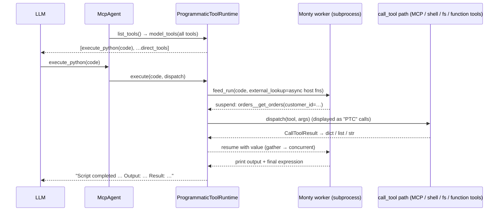

# Programmatic tool calling (PTC) for fast-agent

Status: proof of concept on `feat/ptc-monty-poc` (`fast-agent go --ptc`).

## 1. What Codex does ("code mode")

Codex (`~/reference/codex/codex-rs`) calls this **code mode**. The pieces are:

| Concern | Codex implementation |
| --- | --- |
| Feature gates | `features.code_mode` adds `exec`/`wait` next to direct tools; `features.code_mode_only` makes them the *only* model-visible tools (`core/src/tools/spec_plan.rs`, `ToolMode::{Direct, CodeMode, CodeModeOnly}`). |
| Model-facing tool | `exec`: a **freeform/custom tool** with a Lark grammar, so the model sends raw JavaScript rather than JSON-escaped code (`core/src/tools/code_mode/execute_spec.rs`). An optional first-line pragma `// @exec: {"yield_time_ms":…, "max_output_tokens":…}` sets per-call budgets. |
| Tool catalogue | `code-mode-protocol/src/description.rs` renders every nested tool as a TypeScript declaration (`tools.name(args: {...}): Promise<...>`) from its JSON input schema, with property descriptions as comments. MCP output schemas become `CallToolResult<Structured>`, and a shared MCP TypeScript preamble is included. Names are normalised to JS identifiers. In `code_mode_only` the whole catalogue goes into the `exec` description; in hybrid mode tools are discoverable through `ALL_TOOLS` / `tools.tool_search`. |
| Runtime | V8 isolate per "cell" (`code-mode-runtime`), hosted out of process (`code-mode-host`, gRPC/stdio), so crashes and memory blowups are isolated. There is no filesystem, network or console. |
| Helpers | `text()`, `image()`, `audio()`, `notify()`, `yield_control()`, `exit()`, `store()/load()` for cross-cell state, and `setTimeout`. |
| Nested calls | The runtime calls back into the host. `CodeModeDispatchBroker` turns each nested call into a normal `ToolCall` and routes it through the **same tool router** (`ToolCallSource::CodeMode{cell_id}`), so approvals, sandboxing, hooks and telemetry still apply. MCP tools return the full `CallToolResult` object to the script. |
| Long-running | If a cell is still running after `yield_time_ms`, `exec` returns `Script running with cell ID …`. The companion `wait` tool (`cell_id`, `yield_time_ms`, `max_tokens`, `terminate`) resumes or kills it. |
| Output | A header (`Script completed/failed`, `Wall time …`, `Output:`) followed by the content items, truncated to `max_output_tokens`. |

Pydantic AI's harness (`pydantic_ai_harness/code_mode`) does the same thing on **Monty**: a single `run_code` tool with keyword-only async stubs, a REPL that persists across calls, "last expression is the result" semantics, and errors returned as retry text. It also has optional eager or speculative execution while code is still streaming.

## 2. Mapping to fast-agent + Monty



| Codex | fast-agent PoC |
| --- | --- |
| JavaScript in V8, out of process | Python in **pydantic-monty** (Rust interpreter; `AsyncMonty` worker pool in a subprocess) |
| TypeScript declarations | Python `async def` **stubs** generated from JSON schemas (`ptc/stubs.py`). The same text is shown to the model *and* passed to Monty's bundled `ty` type checker (`type_check_stubs`), so wrong tool names, wrong arguments, unsupported imports and undefined names are rejected **before any tool runs**. Codex has no equivalent. |
| `tools.x(...)` namespace | Bare global functions resolved lazily via `external_lookup`. Names are sanitised to identifiers; builtin and stdlib-module shadows get a `_tool` suffix and keywords get `_` (`list` → `list_tool`, `from` → `from_`). |
| `store()/load()` | Not needed: the Monty REPL session persists globals across `execute_python` calls. |
| `text()` / final output | `print()` plus the value of the final expression. |
| Dispatch broker through the tool router | `McpAgent.call_tool` intercepts `execute_python`. Nested calls go to `_dispatch_tool_call`, the original `call_tool` body, so MCP routing, ACP permission handlers, shell, filesystem, skills and function tools all work. |
| `code_mode_only` / `code_mode` | `ptc.enabled` gives "only" mode; `ptc.direct_tools` (fnmatch) gives hybrid. |
| Output budget | The existing `bound_tool_result_for_llm` byte limit applies to the `execute_python` result. |

## 3. What the PoC implements

- `src/fast_agent/ptc/`
  - `stubs.py`: JSON schema → keyword-only async stubs. It handles enums (`Literal`), unions, arrays, optional parameters (exact schema type with a `= ...` default; omitted arguments are not sent, explicit `None` is only accepted for nullable fields), `**kwargs` only for explicitly open schemas (`additionalProperties: true` or a schema), so a misspelled argument is still a type error, output schemas (summarised in the docstring), and identifier and collision handling.
  - `values.py`: `CallToolResult` → sandbox value. It prefers `structuredContent`, parses JSON text, and summarises media and resources. `isError` raises `RuntimeError` inside the sandbox, where try/except can catch it.
  - `runtime.py`: `ProgrammaticToolRuntime`. It owns a lazily started `AsyncMonty` pool and one persistent session per agent, with limits (`max_feed_duration_secs`, `max_memory`, a high `max_suspensions`). Feeds are serialised with a lock. The session is rebuilt when the tool surface changes, after a timeout (Monty gives no heap guarantees afterwards) or after a crash. Results use a Codex-style header; failures list the tool calls that already completed so the model doesn't repeat side effects.
- `Settings.ptc` (`ProgrammaticToolCallingSettings`): `enabled`, `direct_tools`, `type_check`, `max_duration_seconds`, `max_memory_mb`.
- `fast-agent go --ptc` sets `ptc.enabled` at runtime.
- `McpAgent` integration: `list_tools()` swaps in the code tool, `call_tool()` intercepts it, and nested calls are shown as `(PTC)` tool calls. The code tool carries `{"variant": "code", "language": "python"}` metadata so the existing code display renders highlighted Python while streaming.
- Optional dependency: `fast-agent-mcp[ptc]` (`pydantic-monty>=1.2.0`). It is also in the dev group. A clear `AgentConfigError` is raised if it is missing.
- Demo: `examples/ptc/` (order-analytics MCP server and config).
- Tests: `tests/unit/fast_agent/ptc/test_ptc_runtime.py` runs real Monty for concurrency, persistence, name mapping, type-check rejection and error semantics. The CLI flag test is in `test_go_command.py`.

### End-to-end evidence (gpt-6-astra via Codex OAuth)

Question: "Which EMEA customer has the highest total revenue from delivered orders? … and the runner-up."

```bash
cd examples/ptc
uv run fast-agent go --ptc --servers orders -m "Which EMEA customer has the highest …"
```

The model's single `execute_python` call (reformatted by ruff; the model wrote it as five lines):

```python
import asyncio

customers = (await orders__list_customers(region="EMEA"))["customers"]
results = await asyncio.gather(*[orders__get_orders(customer_id=c["id"]) for c in customers])
ranked = sorted(
    [
        {
            "name": c["name"],
            "id": c["id"],
            "amount": sum(o["total"] for o in r["orders"] if o["status"] == "delivered"),
        }
        for c, r in zip(customers, results)
    ],
    key=lambda x: x["amount"],
    reverse=True,
)
print(ranked[:2])
```

| | direct | `--ptc` |
| --- | --- | --- |
| Model turns | 3 | 2 |
| Model-visible tool calls | 6 | 1 (6 nested, concurrent) |
| Tool-result chars in context | 10,768 | 293 |
| Input tokens | 7,766 | 5,282 |
| Answer | Stark C006 $9,703.40, Aperture | same (correct) |

`--ptc --shell` also works. The shell tool becomes `await shell(input=...)` and keeps its own output display.

## 4. Roadmap

### Phase 1: harden the PoC
1. **Hooks and approvals for nested calls.** Today nested calls bypass `ToolRunnerHooks.before_tool_call/after_tool_call`, which only fire for model-visible calls. Route nested calls through a shared "execute planned call" seam, as Codex does with `ToolCallSource::CodeMode`, so hooks, tool-call planning metadata, result spooling (`_retain_full_tool_result`) and history annotations apply. Record nested calls in the `execute_python` result `_meta` for transcripts and ATIF trajectories.
2. **Agents-as-tools / workflow agents.** `AgentsAsToolsAgent.list_tools()` appends child-agent tools *after* `McpAgent.list_tools()`, so they currently stay direct. Move the PTC transform to the final "tools sent to the LLM" boundary (`ToolRunner` / `ToolAgent.list_tools` consumers) so every agent type is covered once.
3. **Per-agent opt-in.** Add `ptc` to `AgentConfig` and AgentCards (`ptc: true`, `ptc_direct_tools`), with CLI `--ptc` applied like the subagent policy override. Add `--ptc` to `serve` and `acp`.
4. **Display.** Group nested calls under the parent call (indented or aggregated), add a compact "PTC cell" summary, and use the parallel tool-call display when `gather` fans out.
5. **Cancellation.** Ctrl-C or turn cancellation should cancel the feed (`feed_run` task cancel / terminate the worker) and in-flight nested calls.
6. **Readable docstrings in the model-facing catalogue (deferred from review).** Stub docstrings are rendered with `repr()` so that tool descriptions containing backslashes (`C:\Users`), triple quotes or control characters cannot break the type-check stubs. The same text is shown to the model, though, so long descriptions and `Args:` sections appear as single lines with literal `\n`. Either render pretty triple-quoted docstrings for the description and keep `repr()` for `type_check_stubs`, or emit a safely escaped triple-quoted literal for both.
7. **Docs.** Generate a settings reference for `ptc` from the model (`docs/generate_reference_docs.py`), add a user guide page, and add the annotated block to `examples/setup/fast-agent.yaml`.

### Phase 2: parity with Codex
8. **Long-running cells (`wait`).** Run feeds as background tasks with `yield_time_ms`. Return `Script running (cell N)` and add `execute_python_wait(cell_id, yield_time_ms, terminate)`. Monty `feed_start` snapshots also allow host-driven suspension and `dump()` for durable cells.
9. **Media.** Forward image/audio blocks: keep a per-execution media list and expose `image(block)` / `attach(block)` helpers (host functions) whose content is appended to the `execute_python` result, as Codex does with `image()`/`audio()`.
10. **Output budgeting.** Add a token budget per call (`max_output_tokens` parameter) with head/tail truncation, rather than only the byte cap.
11. **Freeform tool input.** For Responses-API models, send `execute_python` as a custom/freeform tool (raw source, no JSON escaping), mirroring Codex's Lark grammar. Keep JSON `{code}` for other providers.
12. **Large catalogues.** When there are many tools, render a compact catalogue (name and one-line description) plus a `describe_tools(pattern)` / `search_tools(query)` host function that returns full stubs, similar to Codex's deferred tools and `tool_search`.
13. **Typed results.** Render MCP output schemas as `TypedDict`s in the stubs so the type checker validates result access, and unwrap FastMCP `{"result": …}` wrappers.

### Phase 3: beyond Codex
14. **Eager or speculative execution** (Pydantic AI `_eager.py` / `_speculation.py`): feed closed statements while the model is still streaming, and pre-launch read-only literal calls.
15. **Session persistence.** `AsyncMontySession.dump()` / `load_session()` alongside fast-agent session history, so `--resume` restores REPL state.
16. **Remote sandbox.** `AsyncMontyWebsocket` for hosted Monty when running `serve`.
17. **Evals.** Add a PTC vs direct benchmark (tokens, turns, accuracy) to `docs/benchmark_*` using the orders demo plus MCP servers with large payloads.

## 5. Risks and notes
- **Monty subset.** No class inheritance, generators, `del`, or `async with/for`; a limited stdlib. Type checking catches most of these up front, and the tool description lists them.
- **Security.** The sandbox only reaches the host through tool functions. Nested calls have exactly the authority of the agent's tools: `--ptc --shell` is still a shell. Approval and permission flows must stay on the nested path (they do today through `call_tool`, apart from tool-runner hooks).
- **Type-check context accumulates** across feeds within a session. This works well in testing; if false positives appear, fall back to Pydantic AI's approach of checking only the first snippet of a fresh REPL.
- **`max_suspensions` is per checkout** and counts name lookups, so the PoC sets it to 100k.
